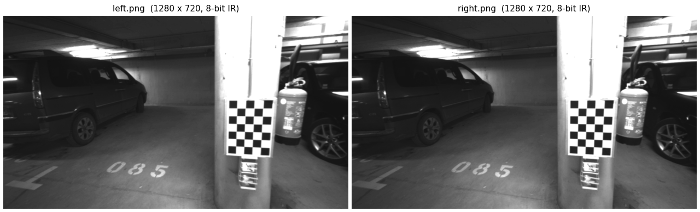
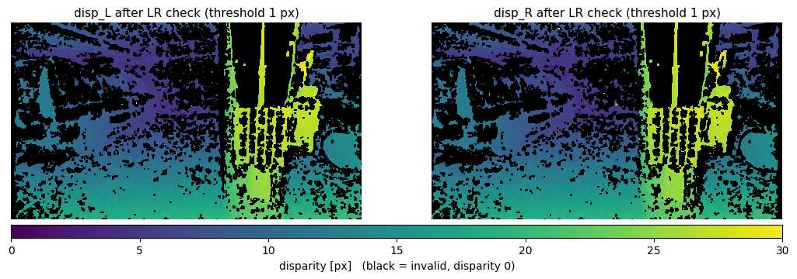
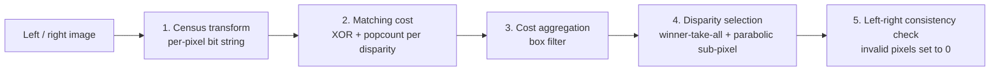
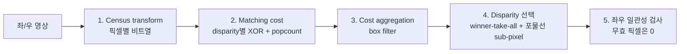

# Census-Transform Stereo Matching

English | [한국어](#한국어)

## English

**Takes two infrared (IR) camera images of the same scene and computes, for every pixel, how far it shifts between the two views.** That shift is the *disparity*: near objects shift more, far objects less, so a disparity map is a depth map up to a known scale (`depth = focal length x baseline / disparity`).

**Input**: a rectified left/right pair of grayscale IR images.



**Output**: one disparity map per view (brighter = larger disparity = closer; black = rejected as unreliable).



(PyTorch implementation on the sample pair: census 7x7, aggregation 11x11, max disparity 48, left-right threshold 1 px.)

### What is in this repository

- **One algorithm, three implementations.** Census-transform stereo matching written in MATLAB (the original reference), PyTorch (the readable one, runs on CPU), and CUDA (the fast one, in three optimisation steps).
- **A step-by-step tutorial.** Nine chapters in `docs/` explain each stage of the algorithm and then walk through the code. The tutorial text is in Korean; code and technical terms are in English.
- **A sample IR pair** in `data/sample/`, so everything can be run right after cloning.

Why census transform for IR: it compares only whether each neighbour is brighter than the centre pixel, not the brightness values themselves, so it tolerates the gain, exposure and illumination differences that are common between two IR sensors.

### Where to start

| If you want to... | Go to |
|---|---|
| See it run in a minute, no GPU needed | [Quick start: PyTorch](#quick-start-pytorch) |
| Understand the algorithm | [Tutorial](#tutorial), chapters 01-05 |
| Read the code alongside an explanation | Chapter [06](docs/06_pytorch_walkthrough.md) (PyTorch), chapters [07](docs/07_cuda_baseline.md)-[09](docs/09_cuda_rolling_buffer.md) (CUDA) |
| Run it on a GPU | [Quick start: CUDA](#quick-start-cuda), after reading [Status](#status-and-known-limitations) |

### Pipeline

Five stages, the same in all three implementations:



### Repository layout

```text
.
├── README.md
├── matlab/
│   ├── imstereo_sch_stereo.m      reference implementation (stages 1-4)
│   └── matching.m                 batch driver + left-right check
├── pytorch/
│   ├── census_stereo.py           implementation and CLI
│   ├── test_census_stereo.py      synthetic-shift tests
│   └── requirements.txt
├── cuda/
│   ├── CMakeLists.txt             builds census_v1, census_v2, census_v3
│   ├── src/
│   │   ├── main.cpp               shared command-line driver
│   │   ├── census.cuh             DiffBoxImages() interface
│   │   ├── pfm_io.{h,cpp}         PFM writer
│   │   ├── v1_baseline.cu         stage 1: separate kernels, full cost volume
│   │   ├── v2_fused.cu            stage 2: fused XOR + sum
│   │   └── v3_rolling.cu          stage 3: rolling cost buffers
│   └── third_party/               helper_cuda.h, helper_string.h
├── data/
│   ├── README.md                  source, licence and properties of the sample pair
│   └── sample/                    left.png, right.png
└── docs/
    ├── 01_census_transform.md ... 09_cuda_rolling_buffer.md
    └── assets/                    figures and the slide PDF
```

### Quick start: PyTorch

```bash
pip install -r pytorch/requirements.txt

cd pytorch
python census_stereo.py --left ../data/sample/left.png --right ../data/sample/right.png \
    --census-size 7 --agg-size 11 --max-disp 48 --lr-threshold 1 --out-dir ../out

python test_census_stereo.py        # or: pytest -q test_census_stereo.py
```

The run needs no GPU (`--device auto` falls back to CPU). On a CPU the sample pair takes a few seconds (3 to 9 s on the laptop used here). The outputs are `out/disp_L.png` and `out/disp_R.png` (normalised visualisations); add `--save-npy` or `--save-pfm` for float disparity values.

### Quick start: CUDA

Requirements: an NVIDIA GPU, the CUDA toolkit, CMake >= 3.18 and OpenCV (core, imgcodecs and highgui components; highgui is required at build time even when running with `--no-display`).

```bash
cmake -S cuda -B cuda/build -DCMAKE_BUILD_TYPE=Release
cmake --build cuda/build -j

mkdir -p out
./cuda/build/census_v3 data/sample/right.png data/sample/left.png \
    --max-disp 48 --census 7 --aggregate 11 --threshold 1 --no-display --out-dir out
```

Note the argument order. In the CUDA program the first image is the reference and its pixel (x, y) is matched with the second image at (x + d, y), d >= 0. For a standard rectified pair the first image must therefore be the one taken by the physically right camera, so the sample command passes `right.png` first. If the result looks empty, swap the two files. The program writes `left.png`, `right.png` (8-bit visualisations) and `left.pfm`, `right.pfm` (float disparity) to `--out-dir`, where "left" and "right" refer to the first and second argument. `census_v1` and `census_v2` take the same arguments. Run with `--help` for all options. See the status section: this code has not been compiled since the reorganisation.

### Tutorial

The chapters in `docs/` are written in Korean.

| Chapter | Topic |
|---|---|
| [01](docs/01_census_transform.md) | Census transform |
| [02](docs/02_matching_cost.md) | Matching cost: XOR + popcount (Hamming distance) |
| [03](docs/03_cost_aggregation.md) | Cost aggregation: box filter |
| [04](docs/04_disparity_subpixel.md) | Disparity selection: winner-take-all and sub-pixel interpolation |
| [05](docs/05_lr_consistency.md) | Left-right consistency check |
| [06](docs/06_pytorch_walkthrough.md) | PyTorch 구현 따라가기 (walkthrough of the PyTorch code, memory, parameter effects, tests) |
| [07](docs/07_cuda_baseline.md) | CUDA baseline: bit-packed census and full cost volume |
| [08](docs/08_cuda_kernel_fusion.md) | Kernel fusion |
| [09](docs/09_cuda_rolling_buffer.md) | Rolling cost buffer |

### Implementation comparison

| Implementation | Language | Cost-volume memory | Notes |
|---|---|---|---|
| MATLAB (`matlab/`) | MATLAB | Full D x H x W volume per direction | Original reference; needs the Image Processing Toolbox; paths in `matching.m` are hard-coded to the original author's data |
| PyTorch (`pytorch/`) | Python | Full volume, `B*H*W*(D+1)*4` bytes per direction; census as bool, `B*H*W*K*K` bytes per view | Runs on CPU or GPU; tested on synthetic pairs and the sample pair |
| CUDA v1 (`census_v1`) | CUDA C++ | Full uint volume, about `8*D*H*W` bytes peak (left volume kept while the right one is built) | Bit-packed census; separate XOR and sum kernels |
| CUDA v2 (`census_v2`) | CUDA C++ | Full uint volume, about `4*D*H*W` bytes (one volume reused) | XOR and sum fused into one kernel |
| CUDA v3 (`census_v3`) | CUDA C++ | None; about `40*H*W` bytes of cost buffers, independent of D | Fused kernel plus rolling 3-slice cost buffers with a running minimum |

For 1280 x 720 with K = 11 and D = 300 (the original defaults), one PyTorch cost volume is about 1.11 GB. For the CUDA versions, peak device memory at the same setting works out to about 2153 MiB (v1), 1088 MiB (v2) and 67 MiB (v3); the derivation is in [chapter 09](docs/09_cuda_rolling_buffer.md). These figures are computed from the `cudaMalloc` sizes in the source, not measured. See [docs/06_pytorch_walkthrough.md](docs/06_pytorch_walkthrough.md) for the PyTorch numbers.

### Sample data

`data/sample/left.png` and `data/sample/right.png` are a rectified 1280 x 720, 8-bit infrared pair (frame 600 of `image_0` / `image_1`) from the public dataset "Digiteo_seq3_Stereo" (El Bouazzaoui, Rodriguez Florez, El Ouardi; Mendeley Data, 2021; DOI 10.17632/c2gtvyxyt7.2), licensed under CC BY 4.0. The images are unmodified. The licence applies to the two images only, not to the code. There is no ground-truth disparity. Details, the full citation and the suggested parameter ranges are in [data/README.md](data/README.md).

### Status and known limitations

- **CUDA code has not been compiled or run after the reorganisation.** The CUDA sources were reorganised (renamed, split into `cuda/src` and `cuda/third_party`, new CMake build) on a machine without a CUDA GPU. They have not been compiled or executed since. No timing numbers exist yet and none are claimed here.
- **Argument order of the CUDA program.** The first image is matched against the second at x + d (see Quick start: CUDA). The PyTorch implementation uses the opposite convention for its `disp_L` (left pixel x matches right pixel x - d).
- **Points to double-check in the CUDA kernels.** Reading the source suggests the two things below. The kernels are unchanged from the original code, which produced reasonable results in actual use, and neither point has been confirmed on a GPU, so treat them as possible issues, not established bugs. Details are in [chapter 07](docs/07_cuda_baseline.md).
  - The per-byte popcount appears to OR the bits together instead of adding them, which would make the cost count differing bytes, not differing bits.
  - For some census window sizes only part of the window rows appears to be encoded (for K = 11, rows 0..7 of 0..10; K = 7, used for the sample, is not affected).
- **PyTorch verification.** The PyTorch results are verified by synthetic shift tests and a run on the sample pair. They have not been compared numerically with the MATLAB output. Known behavioural differences from MATLAB are listed in chapter 06.
- The sample pair has no ground truth, so the "valid pixel" percentages quoted in the docs measure left-right consistency, not accuracy.
- Disparity 0 doubles as "invalid" in the PyTorch output.

License: TBD (no licence file has been added to the code yet).

### References

- R. Zabih and J. Woodfill, "Non-parametric local transforms for computing visual correspondence", ECCV 1994.
- Slides: [docs/assets/Census_and_3D_Recon.pdf](docs/assets/Census_and_3D_Recon.pdf)

---

## 한국어

[English](#english) | 한국어

**같은 장면을 찍은 적외선(IR) 카메라 영상 두 장을 받아, 픽셀마다 두 영상 사이에서 얼마나 옆으로 이동했는지를 계산합니다.** 이 이동량이 *disparity*입니다. 가까운 물체일수록 많이 이동하고 먼 물체일수록 적게 이동하므로, disparity map은 곧 깊이 지도입니다 (`깊이 = 초점거리 x baseline / disparity`).

**입력**: rectified된 좌/우 그레이스케일 IR 영상 한 쌍.


**출력**: 시점별 disparity map (밝을수록 disparity가 크고 가까움, 검은색은 신뢰할 수 없어 버린 픽셀).


(샘플 쌍에 PyTorch 구현을 적용한 결과: census 7x7, aggregation 11x11, max disparity 48, LR threshold 1 px.)

### 이 저장소에 들어 있는 것

- **알고리즘 하나, 구현 셋.** Census transform 스테레오 매칭을 MATLAB(원본 레퍼런스), PyTorch(읽기 쉽고 CPU에서 실행됨), CUDA(빠른 버전, 세 단계로 최적화)로 구현했습니다.
- **단계별 튜토리얼.** `docs/`의 9개 장이 알고리즘의 각 단계를 설명한 뒤 코드를 따라갑니다.
- **샘플 IR 영상 쌍**이 `data/sample/`에 있어 clone 직후 바로 실행해 볼 수 있습니다.

IR 영상에 census transform을 쓰는 이유: 밝기 값 자체가 아니라 "이웃이 중심 픽셀보다 밝은가"만 비교하므로, 두 IR 센서 사이에 흔한 gain, 노출, 조명 차이에 강합니다.

### 어디서부터 볼까

| 하고 싶은 것 | 볼 곳 |
|---|---|
| GPU 없이 1분 안에 돌려 보기 | [빠른 시작: PyTorch](#빠른-시작-pytorch) |
| 알고리즘 이해하기 | [튜토리얼](#튜토리얼) 01~05장 |
| 설명과 함께 코드 읽기 | [06장](docs/06_pytorch_walkthrough.md) (PyTorch), [07](docs/07_cuda_baseline.md)~[09장](docs/09_cuda_rolling_buffer.md) (CUDA) |
| GPU에서 실행하기 | [상태와 알려진 한계](#상태와-알려진-한계)를 읽은 뒤 [빠른 시작: CUDA](#빠른-시작-cuda) |

### 파이프라인

세 구현 모두 같은 5단계를 거칩니다.



### 저장소 구성

```text
.
├── README.md
├── matlab/
│   ├── imstereo_sch_stereo.m      레퍼런스 구현 (1~4단계)
│   └── matching.m                 배치 드라이버 + 좌우 검사
├── pytorch/
│   ├── census_stereo.py           구현과 CLI
│   ├── test_census_stereo.py      합성 shift 테스트
│   └── requirements.txt
├── cuda/
│   ├── CMakeLists.txt             census_v1, census_v2, census_v3 빌드
│   ├── src/
│   │   ├── main.cpp               공통 커맨드라인 드라이버
│   │   ├── census.cuh             DiffBoxImages() 인터페이스
│   │   ├── pfm_io.{h,cpp}         PFM 쓰기
│   │   ├── v1_baseline.cu         1단계: 분리된 커널, 전체 cost volume
│   │   ├── v2_fused.cu            2단계: XOR + sum 융합
│   │   └── v3_rolling.cu          3단계: rolling cost buffer
│   └── third_party/               helper_cuda.h, helper_string.h
├── data/
│   ├── README.md                  샘플 쌍의 출처, 라이선스, 특성
│   └── sample/                    left.png, right.png
└── docs/
    ├── 01_census_transform.md ... 09_cuda_rolling_buffer.md
    └── assets/                    그림과 슬라이드 PDF
```

### 빠른 시작: PyTorch

```bash
pip install -r pytorch/requirements.txt

cd pytorch
python census_stereo.py --left ../data/sample/left.png --right ../data/sample/right.png \
    --census-size 7 --agg-size 11 --max-disp 48 --lr-threshold 1 --out-dir ../out

python test_census_stereo.py        # 또는: pytest -q test_census_stereo.py
```

GPU가 없어도 실행됩니다 (`--device auto`는 CUDA가 없으면 CPU를 씁니다). CPU에서 샘플 쌍은 몇 초면 끝납니다 (작업한 노트북에서 3~9초). 출력은 `out/disp_L.png`, `out/disp_R.png`(정규화한 시각화)이며, 실수 disparity 값이 필요하면 `--save-npy` 또는 `--save-pfm`을 추가하시기 바랍니다.

### 빠른 시작: CUDA

요구 사항: NVIDIA GPU, CUDA toolkit, CMake 3.18 이상, OpenCV (core, imgcodecs, highgui 컴포넌트. `--no-display`로 실행하더라도 빌드할 때 highgui가 필요합니다).

```bash
cmake -S cuda -B cuda/build -DCMAKE_BUILD_TYPE=Release
cmake --build cuda/build -j

mkdir -p out
./cuda/build/census_v3 data/sample/right.png data/sample/left.png \
    --max-disp 48 --census 7 --aggregate 11 --threshold 1 --no-display --out-dir out
```

인자 순서에 주의하시기 바랍니다. CUDA 프로그램에서는 첫 번째 영상이 기준 영상이고, 그 픽셀 (x, y)를 두 번째 영상의 (x + d, y)와 매칭합니다 (d >= 0). 따라서 표준 rectified 쌍에서는 첫 번째 인자가 물리적으로 오른쪽 카메라가 찍은 영상이어야 하며, 샘플 명령이 `right.png`를 먼저 넘기는 이유가 이것입니다. 결과가 비어 보이면 두 파일의 순서를 바꿔 보시기 바랍니다. 프로그램은 `--out-dir`에 `left.png`, `right.png`(8-bit 시각화)와 `left.pfm`, `right.pfm`(실수 disparity)을 쓰며, 여기서 left/right는 첫 번째/두 번째 인자를 뜻합니다. `census_v1`, `census_v2`도 같은 인자를 받습니다. 전체 옵션은 `--help`로 확인하시기 바랍니다. 이 코드는 디렉터리 재구성 이후 컴파일된 적이 없다는 점을 아래 상태 항목에서 확인하시기 바랍니다.

### 튜토리얼

| 장 | 주제 |
|---|---|
| [01](docs/01_census_transform.md) | Census transform |
| [02](docs/02_matching_cost.md) | 매칭 비용: XOR + popcount (Hamming distance) |
| [03](docs/03_cost_aggregation.md) | 비용 집계: box filter |
| [04](docs/04_disparity_subpixel.md) | Disparity 선택: WTA와 sub-pixel 보간 |
| [05](docs/05_lr_consistency.md) | 좌우 일관성 검사 (LR check) |
| [06](docs/06_pytorch_walkthrough.md) | PyTorch 구현 따라가기 |
| [07](docs/07_cuda_baseline.md) | CUDA baseline: bit-packed census와 전체 cost volume |
| [08](docs/08_cuda_kernel_fusion.md) | Kernel fusion |
| [09](docs/09_cuda_rolling_buffer.md) | Rolling cost buffer |

### 구현 비교

| 구현 | 언어 | Cost volume 메모리 | 비고 |
|---|---|---|---|
| MATLAB (`matlab/`) | MATLAB | 방향마다 전체 D x H x W volume | 원본 레퍼런스. Image Processing Toolbox 필요. `matching.m`의 경로는 원 작성자의 데이터에 고정되어 있음 |
| PyTorch (`pytorch/`) | Python | 전체 volume, 방향마다 `B*H*W*(D+1)*4` bytes. census는 bool, view마다 `B*H*W*K*K` bytes | CPU/GPU 실행. 합성 쌍과 샘플 쌍으로 테스트 |
| CUDA v1 (`census_v1`) | CUDA C++ | 전체 uint volume, 정점 약 `8*D*H*W` bytes (오른쪽을 만드는 동안 왼쪽 volume 유지) | Bit-packed census. XOR와 sum이 별도 커널 |
| CUDA v2 (`census_v2`) | CUDA C++ | 전체 uint volume, 약 `4*D*H*W` bytes (volume 하나를 재사용) | XOR와 sum을 한 커널로 융합 |
| CUDA v3 (`census_v3`) | CUDA C++ | volume 없음. cost buffer 약 `40*H*W` bytes, D와 무관 | 융합 커널 + 3-slice rolling cost buffer와 running minimum |

1280 x 720, K = 11, D = 300(원본 기본값)에서 PyTorch cost volume 하나는 약 1.11 GB입니다. 같은 설정에서 CUDA 버전의 device 메모리 정점은 v1 약 2153 MiB, v2 약 1088 MiB, v3 약 67 MiB로 계산됩니다 (유도는 [09장](docs/09_cuda_rolling_buffer.md)). 이 수치는 소스의 `cudaMalloc` 크기로 계산한 값이며 실측이 아닙니다. PyTorch 수치는 [docs/06_pytorch_walkthrough.md](docs/06_pytorch_walkthrough.md)를 참고하시기 바랍니다.

### 샘플 데이터

`data/sample/left.png`, `data/sample/right.png`는 공개 데이터셋 "Digiteo_seq3_Stereo"(El Bouazzaoui, Rodriguez Florez, El Ouardi, Mendeley Data, 2021, DOI 10.17632/c2gtvyxyt7.2)의 `image_0` / `image_1` 600번 프레임으로, rectified된 1280 x 720, 8-bit 적외선 영상 쌍입니다. 라이선스는 CC BY 4.0이고 영상은 수정하지 않았습니다. 이 라이선스는 두 영상에만 적용되며 코드에는 적용되지 않습니다. Ground truth disparity는 없습니다. 전체 인용 정보와 권장 파라미터 범위는 [data/README.md](data/README.md)에 있습니다.

### 상태와 알려진 한계

- **CUDA 코드는 재구성 이후 컴파일하거나 실행한 적이 없습니다.** CUDA 소스는 CUDA GPU가 없는 환경에서 재구성했습니다 (파일 이름 변경, `cuda/src`와 `cuda/third_party` 분리, 새 CMake 빌드). 이후 컴파일도 실행도 하지 않았습니다. 시간 측정 수치는 아직 없으며 이 문서에서도 주장하지 않습니다.
- **CUDA 프로그램의 인자 순서.** 첫 번째 영상이 두 번째 영상의 x + d와 매칭됩니다 (빠른 시작: CUDA 참고). PyTorch 구현의 `disp_L`은 반대 규약입니다 (왼쪽 픽셀 x가 오른쪽 픽셀 x - d와 매칭).
- **CUDA 커널에서 확인이 필요한 부분.** 소스를 읽어 보면 아래 두 가지가 의심됩니다. 커널은 원본 그대로이고, 원본은 실제 사용에서 정상적인 결과를 냈으며, 두 항목 모두 GPU에서 확인하지 않았습니다. 확정된 버그가 아니라 문제일 수 있는 부분으로 읽어 주시기 바랍니다. 자세한 내용은 [07장](docs/07_cuda_baseline.md)에 있습니다.
  - Byte 단위 popcount가 비트를 더하지 않고 OR로 합치는 것으로 보입니다. 그렇다면 cost는 다른 비트 수가 아니라 다른 byte 수를 세게 됩니다.
  - 일부 census 윈도우 크기에서는 윈도우 행의 일부만 인코딩되는 것으로 보입니다 (K = 11이면 0~10행 중 0~7행. 샘플에 쓰는 K = 7은 해당 없음).
- **PyTorch 검증 범위.** PyTorch 결과는 합성 shift 테스트와 샘플 쌍 실행으로 검증했습니다. MATLAB 출력과 수치로 비교하지는 않았습니다. MATLAB과의 동작 차이는 06장에 정리되어 있습니다.
- 샘플 쌍에는 ground truth가 없으므로, 문서에 나오는 "유효 픽셀" 비율은 정확도가 아니라 좌우 일관성을 나타냅니다.
- PyTorch 출력에서 disparity 0은 "무효"를 겸합니다.

License: TBD (코드에 대한 라이선스 파일은 아직 추가하지 않았습니다).

### 참고 문헌

- R. Zabih and J. Woodfill, "Non-parametric local transforms for computing visual correspondence", ECCV 1994.
- 슬라이드: [docs/assets/Census_and_3D_Recon.pdf](docs/assets/Census_and_3D_Recon.pdf)
