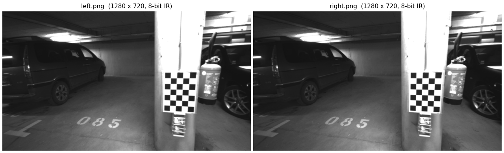
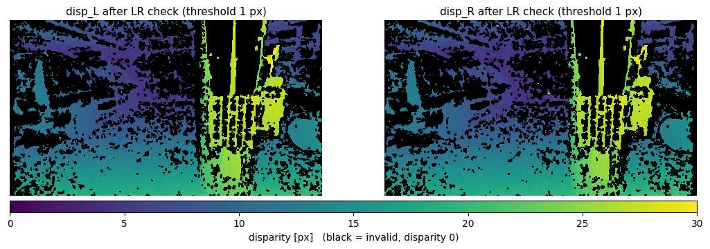
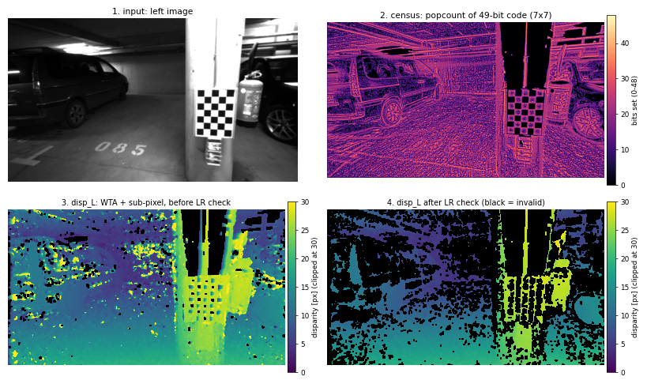
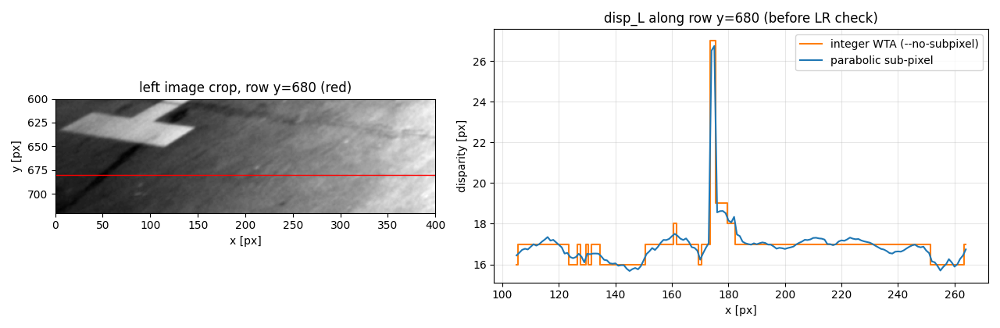

# PyTorch 구현 따라가기

[이전: 05. Left-Right Consistency](05_lr_consistency.md) | [다음: 07. CUDA baseline](07_cuda_baseline.md)

01~05장에서 각 단계의 이론을 설명했습니다. 이 장에서는 그 내용을 `pytorch/census_stereo.py` 한 파일에서 코드로 다시 확인합니다. 설치와 실행, `get_disparity` 호출 그래프를 따라가는 코드 읽기, 단계별 tensor shape, 메모리 사용량, 파라미터를 바꿨을 때의 변화, 테스트, MATLAB 원본과의 차이 순서로 진행합니다.

이 장에 나오는 숫자와 출력은 모두 CPU에서 직접 실행해 얻은 값입니다. 시간은 실행 때마다 흔들리므로 대략적인 값으로만 보시기 바랍니다.



## 1. 설치

필요한 패키지는 `pytorch/requirements.txt`에 있습니다.

```text
torch>=2.0
torchvision>=0.15
numpy
pytest
```

```bash
python -m venv .venv && source .venv/bin/activate
pip install -r pytorch/requirements.txt
```

GPU는 필수가 아닙니다. `--device auto`(기본값)는 `torch.cuda.is_available()`이 참이면 CUDA를, 아니면 CPU를 선택합니다. `--device cpu`로 CPU를 강제할 수도 있습니다. 이 장의 모든 실행은 CPU에서 했습니다.

이 장을 작성할 때 확인한 버전은 torch 2.8.0, torchvision 0.23.0, numpy 2.0.2입니다.

## 2. CLI 실행

샘플 스테레오 쌍(`data/sample/`, 1280 x 720, 8-bit 단일 채널)에 대해 다음처럼 실행했습니다. `data/README.md`의 시차 범위 측정에 맞춰 `--max-disp 48`을 썼습니다.

```bash
cd pytorch
python census_stereo.py --left ../data/sample/left.png --right ../data/sample/right.png \
    --census-size 7 --agg-size 11 --max-disp 48 --lr-threshold 1 \
    --out-dir ../out --save-npy
```

실제 출력은 한 줄입니다.

```text
device=cpu time=3.11s
```

`out/` 디렉터리에는 `disp_L.png`, `disp_R.png`, `disp_L.npy`, `disp_R.npy`가 생깁니다 (`--save-pfm`을 주면 `.pfm`도 생깁니다). PNG는 각 맵의 최댓값으로 나눠 0~1로 정규화한 8-bit 시각화일 뿐이므로, 시차 값 자체가 필요하면 `.npy`나 `.pfm`을 쓰셔야 합니다. `disp_*.png`와 `*.npy`, `*.pfm`은 `.gitignore`에 들어 있어 커밋되지 않습니다.

옵션 목록과 기본값은 다음과 같습니다 (`main()`, [pytorch/census_stereo.py:237-264](../pytorch/census_stereo.py#L237-L264)).

| 옵션 | 기본값 | 의미 |
|---|---|---|
| `--min-disp`, `--max-disp` | 0, 300 | 탐색하는 시차 범위(양끝 포함). 시차 개수는 `max-min+1` |
| `--census-size` | 11 | census 윈도우 크기 (홀수) |
| `--agg-size` | 11 | box filter 윈도우 크기 |
| `--lr-threshold` | 10 | LR check 허용 오차 (px) |
| `--no-subpixel` | 꺼짐 | 주면 sub-pixel 보정을 끕니다 |
| `--device` | `auto` | `cpu`, `cuda`, `cuda:0` 등 |

기본값(K=11, max_disp=300)은 원본 MATLAB 스크립트의 값을 그대로 따른 것입니다. 샘플 쌍은 시차가 대략 30 px 이하이므로 그대로 쓰면 낭비가 큽니다. 같은 샘플을 기본값으로 실행하면 42.24초가 걸렸고, 최대 resident set은 약 2.36 GB였습니다 (`/usr/bin/time -l` 측정). 같은 샘플을 위의 `--census-size 7 --max-disp 48` 설정으로 다시 실행했을 때는 3.92초, 약 1.35 GB였습니다.

결과는 다음과 같습니다. 검은색은 LR check를 통과하지 못했거나 시차가 0인 픽셀입니다.



이 설정에서 `disp_L`의 유효 픽셀 비율은 74.2%, `disp_R`은 73.9%였습니다. 이 비율은 정확도가 아니라 "LR check를 통과한 비율"일 뿐이라는 점에 유의하시기 바랍니다. 이 샘플에는 ground truth가 없어서 정확도는 측정하지 못했습니다.

## 3. 호출 그래프

`main()`이 `get_disparity()`를 부르고, `get_disparity()`가 5단계를 순서대로 실행합니다.

```text
main
 └─ get_disparity                                  ([187-198])
     ├─ stereo_matching                            ([133-148])  stage 1-4, 양쪽 view
     │   ├─ census_transform  (left, right)        ([31-49])    stage 1
     │   ├─ build_cost_volume (R 기준, 이어서 L 기준) ([75-93])  stage 2-3
     │   │   └─ shift_census                       ([55-72])
     │   └─ winner_take_all                        ([122-130])  stage 4
     │       └─ refine_subpixel                    ([99-119])
     └─ left_right_check                           ([176-184])  stage 5
         └─ disparity_interp                       ([164-173])
             └─ _sample_rows_linear                ([154-161])
```

단계별 결과를 한 장에 모으면 다음과 같습니다. 왼쪽 위는 입력, 오른쪽 위는 census 비트열의 popcount(1인 비트 개수), 왼쪽 아래는 LR check 전의 WTA + sub-pixel 시차, 오른쪽 아래는 LR check 이후입니다 (LR check 이전 시차 지도에서 보이는 노란색 얼룩은 컬러바 상한 30 px을 넘은 값입니다).



### 3.1 시차 부호 규약

모듈 docstring ([pytorch/census_stereo.py:11-15](../pytorch/census_stereo.py#L11-L15))에 규약이 정리되어 있습니다.

```python
Disparity convention (rectified pair, positive disparities):
    disp_L[y, x] = d  means  left(y, x)  matches  right(y, x - d)
    disp_R[y, x] = d  means  right(y, x) matches  left(y, x + d)
Both maps are positive for a normal pair (objects shift LEFT in the right image).
Invalid pixels after the left-right check are 0.
```

시차 0이 "무효"를 겸한다는 점이 중요합니다. 실제로 시차가 0에 가까운 먼 픽셀과 LR check에서 걸러진 픽셀이 같은 값 0으로 저장됩니다. 샘플에서 LR check 이전의 `disp_L`만 해도 5.84%가 0입니다 (WTA가 인덱스 0을 고른 경우). 이 비율은 이 설정에서 측정한 값입니다. 무효를 구분해서 쓰고 싶다면 NaN 같은 별도 표식을 쓰도록 바꿔야 합니다.

### 3.2 Stage 1: census_transform

[pytorch/census_stereo.py:31-49](../pytorch/census_stereo.py#L31-L49)

```python
bz, _, h, w = img.shape
r = census_size // 2
padded = F.pad(img.float(), (r, r, r, r))
blocks = F.unfold(padded, kernel_size=census_size)          # (B, k*k, H*W)
centre = (census_size ** 2) // 2                            # 0-based centre
bits = blocks > blocks[:, centre:centre + 1, :]             # (B, k*k, H*W)
return bits.reshape(bz, census_size ** 2, h, w).permute(0, 2, 3, 1)
```

`F.unfold`가 각 픽셀의 K x K 이웃을 열 벡터로 펼치고, 중심 값과 비교해 비트열을 만듭니다. 이웃이 중심보다 "엄밀히 더 밝으면" 1입니다. 따라서 중심 비트(인덱스 `K*K//2`)는 항상 0입니다 (테스트가 이를 확인합니다). 경계는 0으로 패딩하므로, 이미지 바깥 이웃은 (중심보다 밝을 수 없어) 항상 비트 0이 됩니다. 이미지 가장자리 근처의 비트열은 이 때문에 실제 장면과 무관한 값을 일부 포함합니다. 이론은 [01장](01_census_transform.md)을 참고하시기 바랍니다.

반환값은 bool tensor이며 비트가 1 byte씩 차지합니다. CUDA 버전은 이것을 8비트씩 묶어 저장합니다 (07장).

### 3.3 Stage 2-3: shift_census와 build_cost_volume

[pytorch/census_stereo.py:55-72](../pytorch/census_stereo.py#L55-L72)

```python
out = torch.zeros_like(census)
w = census.size(2)
if shift >= w:
    return out
if shift == 0:
    return census.clone()
if direction < 0:
    out[:, :, :w - shift, :] = census[:, :, shift:, :]
else:
    out[:, :, shift:, :] = census[:, :, :w - shift, :]
return out
```

`shift_census`는 target census 맵을 W 방향으로 `shift`만큼 밀고, 소스가 없는 열은 0으로 채웁니다 (wrap-around 없음). 정확히 `shift`개의 열이 0이 됩니다.

[pytorch/census_stereo.py:75-93](../pytorch/census_stereo.py#L75-L93)

```python
bz, h, w, _ = census_ref.shape
n = max_disp - min_disp + 1
box = torch.ones((1, 1, agg_size, agg_size), device=census_ref.device)
volume = torch.empty((bz, h, w, n), dtype=torch.float32, device=census_ref.device)
for i in range(n):
    tgt = shift_census(census_tgt, min_disp + i, direction)
    hamming = torch.bitwise_xor(census_ref, tgt).sum(dim=3, dtype=torch.float32)  # (B,H,W)
    volume[..., i] = F.conv2d(hamming.unsqueeze(1), box, padding='same')[:, 0]
return volume
```

시차 후보마다 (1) target을 밀고, (2) XOR 후 비트 합으로 Hamming 거리를 구하고 ([02장](02_matching_cost.md)), (3) 전체 ones 커널 conv2d로 box aggregation을 합니다 ([03장](03_cost_aggregation.md)). 시차 후보를 파이썬 for 루프로 하나씩 처리하고, 결과는 `(B, H, W, N)` float32 cost volume에 쌓습니다. `padding='same'`은 경계를 0으로 패딩합니다.

`stereo_matching`은 이 함수를 두 번 부릅니다. 오른쪽 view를 기준으로 할 때는 `direction=-1`(target인 left를 왼쪽으로 밀기), 왼쪽 view를 기준으로 할 때는 `+1`입니다 ([133-148](../pytorch/census_stereo.py#L133-L148)).

```python
cost_R = build_cost_volume(census_R, census_L, min_disp, max_disp, aggreate_size, -1)
disp_R = winner_take_all(cost_R, min_disp, sub_pixel)
del cost_R
cost_L = build_cost_volume(census_L, census_R, min_disp, max_disp, aggreate_size, +1)
disp_L = winner_take_all(cost_L, min_disp, sub_pixel)
```

`del cost_R`로 첫 번째 volume을 해제해 cost volume이 동시에 두 개 존재하지 않게 합니다. 파라미터 이름이 `aggreate_size`로 오타 그대로인 것은 MATLAB 원본의 `aggreate_filter_size`를 따른 것입니다.

### 3.4 Stage 4: winner_take_all과 refine_subpixel

[pytorch/census_stereo.py:99-130](../pytorch/census_stereo.py#L99-L130)

```python
idx = torch.argmin(cost, dim=3)
disp = refine_subpixel(idx, cost) if sub_pixel else idx.float()
return disp + min_disp
```

```python
i = idx.clamp(1, n - 2).unsqueeze(-1)
c_d = cost.gather(3, i)[..., 0]
c_m = cost.gather(3, i - 1)[..., 0]
c_p = cost.gather(3, i + 1)[..., 0]
denom = 2 * (2 * c_d - c_m - c_p)
valid = (idx > 0) & (idx < n - 1) & (denom != 0) & torch.isfinite(denom)
```

`argmin`으로 정수 시차를 고르고, 포물선 보정 `idx + (c[i+1]-c[i-1]) / (2*(2c[i]-c[i-1]-c[i+1]))`을 더합니다 ([04장](04_disparity_subpixel.md)). 보정은 이웃이 양쪽에 모두 있는 interior 인덱스(`0 < idx < N-1`)에서만 적용되고, 분모가 0이면(평평한 cost) 정수 값을 유지합니다. 경계 인덱스를 `clamp(1, n-2)`로 안전하게 gather한 뒤 `valid` 마스크로 걸러내는 구조입니다.

정수 시차와 sub-pixel 시차를 한 행(row)에서 비교하면 다음과 같습니다. 정수 시차는 계단 모양이고, 포물선 보정은 그 사이를 매끄럽게 채웁니다. 이 그림은 LR check 이전의 `disp_L`이며, 보정 효과는 보이지만 보정이 더 정확하다는 것을 ground truth로 확인한 것은 아닙니다.



### 3.5 Stage 5: left_right_check

[pytorch/census_stereo.py:154-184](../pytorch/census_stereo.py#L154-L184)

```python
cols = cols.clamp(0, w - 1)
c0 = torch.floor(cols).long()
c1 = (c0 + 1).clamp(max=w - 1)
alpha = cols - c0
return alpha * disp.gather(2, c1) + (1 - alpha) * disp.gather(2, c0)
```

```python
disp_R2L, disp_L2R = disparity_interp(disp_L, disp_R)
out_L = torch.where((disp_R2L - disp_L).abs() > threshold, torch.zeros_like(disp_L), disp_L)
out_R = torch.where((disp_L2R - disp_R).abs() > threshold, torch.zeros_like(disp_R), disp_R)
```

각 `disp_L[y, x]`가 가리키는 오른쪽 열 `x - disp_L`에서 `disp_R`을 선형 보간으로 읽어 두 값이 `threshold` 이상 어긋나면 0으로 만듭니다 ([05장](05_lr_consistency.md)). 입력은 바꾸지 않고 새 tensor를 반환합니다. 샘플 쌍에서 임계값에 따른 변화는 이 장의 6절에서 다룹니다.

### 3.6 get_disparity

[pytorch/census_stereo.py:187-198](../pytorch/census_stereo.py#L187-L198)

```python
disp_L, disp_R = stereo_matching(left_img, right_img, min_disp, max_disp,
                                 aggreate_size, census_size, sub_pixel, device)
disp_L, disp_R = left_right_check(disp_L, disp_R, threshold)
if visualize:
    save_disparity(disp_L, disp_R, out_dir)
return disp_L, disp_R
```

라이브러리로 쓸 때는 `(B, 1, H, W)` 입력 tensor로 `get_disparity`를 직접 호출하시면 됩니다. 반환값은 float32 `(B, H, W)`이고 무효는 0입니다. 직접 호출할 때 `threshold` 기본값은 10입니다 (CLI와 같습니다).

## 4. 단계별 tensor shape

1280 x 720 샘플, `census_size=7`, `max_disp=48`에서 직접 출력한 값입니다 (B=1).

| 단계 | 변수 | shape | dtype |
|---|---|---|---|
| 입력 | `left_img` | `(1, 1, 720, 1280)` | uint8 (그대로 `.float()` 변환 후 사용) |
| census (`F.unfold` 직후) | `blocks` | `(1, 49, 921600)` | float32 |
| census 결과 | `census_L` | `(1, 720, 1280, 49)` | bool |
| Hamming (루프 안) | `hamming` | `(1, 720, 1280)` | float32 |
| cost volume | `cost_R` | `(1, 720, 1280, 49)` | float32 |
| WTA 이후 | `disp_R` | `(1, 720, 1280)` | float32 |
| LR check 이후 | `disp_L`, `disp_R` | `(1, 720, 1280)` | float32 |

우연히 census 마지막 축(`K*K = 49`)과 cost volume 마지막 축(`max_disp+1 = 49`)이 같지만, 둘은 서로 다른 의미입니다 (비트 수와 시차 후보 수).

## 5. 메모리

PyTorch 구현의 두 큰 tensor는 다음과 같습니다.

- census bool tensor: `B * H * W * K * K` bytes (비트 하나가 1 byte)
- cost volume: `B * H * W * (max_disp - min_disp + 1) * 4` bytes (float32)

1280 x 720 = 921,600 픽셀, B=1로 계산한 값입니다.

| 설정 | census (view 하나) | cost volume (방향 하나) |
|---|---|---|
| K=7, max_disp=48 (시차 49개) | 921600 x 49 = 45,158,400 B = 45.2 MB | 921600 x 49 x 4 = 180,633,600 B = 180.6 MB |
| K=11, max_disp=300 (시차 301개, 원본 기본값) | 921600 x 121 = 111,513,600 B = 111.5 MB | 921600 x 301 x 4 = 1,109,606,400 B = 1.11 GB |

(MB, GB는 10^6, 10^9 byte 기준입니다. 첫 번째 행의 두 수는 코드에서 직접 `numel() * element_size()`로 확인했고, 두 번째 행은 같은 식으로 계산한 값입니다.)

위 표는 상시 보관되는 tensor만 센 값입니다. 실제로는 다음이 더해집니다.

- 양쪽 view의 census를 모두 들고 있으므로 census는 2개입니다.
- 루프 안에서 `shift_census` 결과와 XOR 결과가 각각 census 한 개 크기의 임시 bool tensor입니다.
- `census_transform` 안의 `F.unfold` 결과는 float32이므로 bool census보다 4배 큽니다 (K=11에서는 약 446 MB). 일시적이지만 정점 메모리에 영향을 줍니다.

실제 정점 메모리는 `/usr/bin/time -l`로 측정한 최대 resident set size로 확인했습니다. K=7, max_disp=48 설정은 약 1.35 GB, 기본값(K=11, max_disp=300)은 약 2.36 GB였습니다 (CPU 실행, Python과 torch 런타임 자체의 메모리 포함).

이 숫자들이 CUDA 장에서 다루는 문제의 출발점입니다.

- cost volume은 `max_disp`에 비례해서 커집니다. 1280 x 720에 시차 301개면 volume 하나가 1 GB를 넘고, 해상도나 시차 범위가 더 커지면 GPU 메모리에 올릴 수 없게 됩니다.
- bool tensor로 비트를 1 byte씩 저장하는 것은 낭비입니다. 8비트를 한 byte에 담으면 census 메모리와 XOR 대역폭이 1/8로 줄어듭니다 (07장).
- 시차마다 shift, XOR, sum, box filter를 따로 실행하면 커널(연산) 간 메모리 왕복이 많습니다. 08장은 이것을 하나의 커널로 합칩니다.
- 시차마다 cost를 volume에 저장하지 않고 "지금까지의 최솟값"만 유지하면 메모리가 `max_disp`와 무관해집니다 (09장).

## 6. 파라미터 튜닝

아래 표는 샘플 쌍에서 파라미터를 하나씩 바꿔 가며 측정한 값입니다 (기준: census 7, agg 11, max_disp 48, sub-pixel 켬, LR threshold 1). "유효 비율"은 LR check 이후 `disp_L > 0`인 픽셀의 비율입니다. 이 값이 높다고 결과가 정확하다는 뜻은 아닙니다. 아래에 보이듯 임계값을 높이면 유효 비율은 단조롭게 증가하지만 그중 일부는 틀린 매칭입니다. ground truth가 없으므로 정확도 비교는 하지 못했습니다.

### LR threshold

| `--lr-threshold` | 유효 비율 (`disp_L`) | 유효 비율 (`disp_R`) |
|---|---|---|
| 0.5 | 69.5% | 69.2% |
| 1 | 74.2% | 73.9% |
| 2 | 77.1% | 76.8% |
| 5 | 81.4% | 81.2% |
| 10 (기본값) | 85.7% | 85.5% |

임계값을 키울수록 통과하는 픽셀은 늘어나지만 틀린 매칭도 같이 통과합니다. 기본값 10은 시차 범위가 300인 원본 데이터에 맞춘 값이므로, 이 샘플처럼 시차가 30 px 안팎일 때는 너무 느슨합니다. 이 장에서는 1을 썼습니다.

### Census 윈도우 크기 (agg 11, max 48, threshold 1)

| census | 유효 비율 (`disp_L`) |
|---|---|
| 3 | 67.3% |
| 5 | 71.6% |
| 7 | 74.2% |
| 9 | 76.0% |
| 11 | 77.3% |

윈도우가 커질수록 비트열이 길어져 변별력이 올라가지만 계산량도 비례해서 늘어납니다 (이 CPU에서 census 3은 3초대, 9와 11은 8~9초대였습니다. 각 설정을 한 번씩만 측정한 값입니다).

### Aggregation 윈도우 크기 (census 7, max 48, threshold 1)

| agg | 유효 비율 (`disp_L`) | LR check 이전 시차가 0인 비율 |
|---|---|---|
| 3 | 45.9% | 9.03% |
| 5 | 55.6% | 7.78% |
| 7 | 63.4% | 6.99% |
| 11 | 74.2% | 5.84% |
| 15 | 80.1% | 5.00% |
| 21 | 85.4% | 3.98% |

aggregation 윈도우의 영향이 census 크기보다 훨씬 큽니다. 윈도우가 작으면 텍스처가 없는 콘크리트 바닥에서 비용이 모호해지기 쉽고, 윈도우가 커지면 매끄러운 영역은 안정되지만 물체 경계에서 시차가 번질 수 있습니다. 후자의 영향은 이 표의 숫자로는 드러나지 않으므로 지도를 직접 보시기 바랍니다.

### max_disp (census 7, agg 11, threshold 1)

| `--max-disp` | 유효 비율 (`disp_L`) |
|---|---|
| 32 | 75.3% |
| 48 | 74.2% |
| 64 | 73.4% |

`data/README.md`의 측정에서 이 샘플의 시차 상한은 약 30 px입니다. 탐색 범위를 넓히면 잘못된 후보가 늘어 유효 비율이 약간 줄어듭니다. 범위를 넓히는 비용(시간과 cost volume 크기)은 시차 개수에 비례합니다.

### Sub-pixel 보정 끄기

`--no-subpixel`로 실행하면 같은 설정에서 유효 비율이 76.0%(켰을 때 74.2%)입니다. 정수 시차끼리는 LR 비교에서 어긋날 여지가 작아 임계값 1에서 더 많이 통과하는 것으로 보입니다. 이것은 sub-pixel 보정이 나쁘다는 뜻이 아니라, 임계값 1이 정수 시차에는 더 느슨하게 작용한다는 뜻으로 읽으시는 것이 맞습니다 (원인은 검증하지 않았습니다).

## 7. 테스트

```bash
cd pytorch
python test_census_stereo.py      # 또는 pytest -q test_census_stereo.py
```

실제 실행 결과는 7개 테스트 모두 통과(`all 7 tests passed`)였고, `pytest -q`도 `7 passed`였습니다.

테스트는 합성 데이터에 대한 smoke test입니다. 핵심은 `make_pair(d)`입니다. 무작위 노이즈 이미지 `left`를 만들고, `right(x) = left(x + d)`가 되도록 오른쪽 이미지를 구성합니다. 즉 내용이 오른쪽 이미지에서 정확히 `d`만큼 왼쪽으로 이동한 쌍이고, 정답 시차는 모든 곳에서 `d`입니다. 테스트는 census 5, aggregation 5에서 경계 여백(`census//2 + agg//2`)과 이동으로 가려진 열을 제외한 영역이 정답 `d`와 같은지 확인합니다.

| 테스트 | 확인하는 것 |
|---|---|
| `test_centre_bit_never_set` | 중심 비트가 항상 0이고, shape이 `(B, H, W, K*K)`인지 (K=3, 5, 11) |
| `test_constant_disparity` | d=7에서 오차 0 (정수 시차) |
| `test_zero_disparity` | d=0에서 오차 0 |
| `test_min_disp_offset` | `min_disp=2`, d=5에서 `min_disp` 오프셋 처리 |
| `test_subpixel_on` | sub-pixel 켰을 때 오차 0.5 이하 (실제 최대 오차 0.046) |
| `test_full_pipeline_with_lr_check` | LR check까지 포함해도 같은 영역에서 정답과 일치 |
| `test_batch_matches_single` | 배치로 돌린 결과가 개별 실행과 일치 (batch-correct) |

테스트가 검증하지 않는 것도 분명히 해 두겠습니다. 합성 데이터는 텍스처가 풍부한 노이즈 이미지이고 가려짐(occlusion)이 없는 전역 시프트뿐이라, 실제 장면의 어려운 경우(텍스처 없는 영역, 가려짐, 반복 패턴)는 다루지 않습니다. 그리고 MATLAB 원본의 출력과 수치로 비교하는 테스트는 없습니다.

## 8. MATLAB 원본과의 차이

`matlab/imstereo_sch_stereo.m`(stage 1-4)과 `matlab/matching.m`(LR check와 배치 드라이버)이 원본입니다. PyTorch 버전은 같은 흐름을 따르지만, 코드를 읽어 비교했을 때 다음 차이가 있습니다.

| 항목 | MATLAB | PyTorch |
|---|---|---|
| shift 후 0으로 채우는 열 | `circshift` 후 `imL_d(:, end-s:end, :) = 0`으로 s+1개 열 | `shift_census`가 정확히 s개 열 |
| 경계 시차 인덱스의 sub-pixel | `tar_idx`로 interior만, 분모 0 검사 없음 | interior만, `denom != 0`과 유한성도 검사 |
| LR check의 범위 밖 샘플링 | `interp2(..., 'linear', 0)`이 범위 밖에서 0을 반환 | 열 인덱스를 `clamp(0, W-1)`해서 가장자리 값을 읽음 |
| 시차 0 | 0이 무효 표식을 겸함 | 같음 |
| 배치 | 이미지 쌍 하나씩 | `(B, 1, H, W)` 배치를 지원 |
| 실행 환경 | Image Processing Toolbox, 선택적으로 GPU (`gpuArray`) | PyTorch, CPU 또는 CUDA |
| 비용 초기화 | volume을 `Inf`로 초기화 | `torch.empty` (모든 시차를 채우므로 무관) |

첫 번째 차이에서 PyTorch는 시차 s일 때 실제로 소스가 없는 열 수(s개)만 0으로 채우고, MATLAB은 열 하나를 더(s+1개) 0으로 만듭니다. 세 번째 차이로 PyTorch에서는 이미지 가장자리 근처에서 MATLAB보다 LR check를 통과하는 픽셀이 늘 수 있습니다. 그 영향이 어느 정도인지는 측정하지 않았습니다.

이 비교는 코드를 읽어서 얻은 것입니다. PyTorch 출력이 MATLAB 출력과 수치로 일치하는지는 검증하지 않았습니다 (MATLAB 환경에서 같은 이미지를 실행해 비교한 적이 없습니다). 현재 검증된 것은 7.절의 합성 테스트와 샘플 쌍 실행이 전부입니다. 위의 차이들 때문에 가장자리 근처에서 결과가 일치하지 않을 수 있습니다.

---

[이전: 05. Left-Right Consistency](05_lr_consistency.md) | [다음: 07. CUDA baseline](07_cuda_baseline.md)
