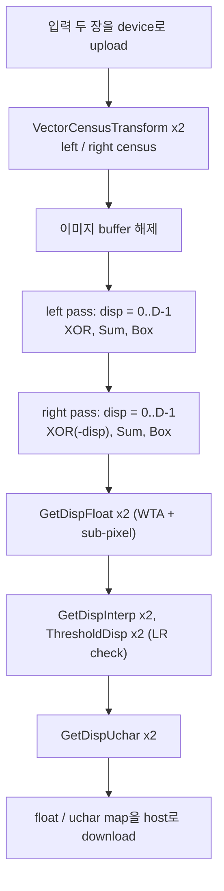

# 07. CUDA baseline: bit-packed census와 전체 cost volume

이전 장 [06. PyTorch walkthrough](06_pytorch_walkthrough.md)에서는 같은 파이프라인을 텐서 연산으로 구현했습니다. 이 장부터 세 장(07-09)은 이 파이프라인을 CUDA로 옮기고 세 단계에 걸쳐 최적화합니다.

| 장 | 실행 파일 | 소스 | 핵심 변화 |
|---|---|---|---|
| 07 | `census_v1` | [v1_baseline.cu](../cuda/src/v1_baseline.cu) | 단순 포팅. XOR, Sum을 별도 kernel로 두고 방향마다 전체 cost volume 저장 |
| 08 | `census_v2` | [v2_fused.cu](../cuda/src/v2_fused.cu) | XOR + Sum을 한 kernel로 합치고 cost volume 하나를 재사용 |
| 09 | `census_v3` | [v3_rolling.cu](../cuda/src/v3_rolling.cu) | cost volume을 없애고 3-slice rolling buffer만 유지 |

세 실행 파일은 같은 [cuda/src/main.cpp](../cuda/src/main.cpp)(명령행 처리, 이미지 입출력)를 쓰고, `DiffBoxImages()` 구현이 들어 있는 `.cu` 파일만 다릅니다. 파이프라인의 이론은 다시 설명하지 않고 링크로 대신합니다: census transform은 [01](01_census_transform.md), matching cost는 [02](02_matching_cost.md), cost aggregation은 [03](03_cost_aggregation.md), WTA와 sub-pixel은 [04](04_disparity_subpixel.md), left-right consistency는 [05](05_lr_consistency.md)입니다.

> **검증 상태.** 이 저장소의 코드는 CUDA가 없는 환경에서 디렉터리 구조를 정리했고, 그 이후 컴파일하거나 실행해 본 적이 없습니다. 따라서 세 장 어디에도 실행 시간 측정값이 없으며, 속도 향상 배수도 적지 않습니다. 메모리 수치는 소스의 `cudaMalloc` 크기에서 계산한 값입니다.

## 1. 빌드와 실행

필요한 것은 CUDA toolkit, CMake 3.18 이상, OpenCV(core, imgcodecs, highgui)입니다 ([cuda/CMakeLists.txt:1](../cuda/CMakeLists.txt#L1), [:24-25](../cuda/CMakeLists.txt#L24-L25)).

```bash
cd cuda
cmake -S . -B build
cmake --build build -j
```

`build/` 아래에 `census_v1`, `census_v2`, `census_v3`가 만들어집니다 ([cuda/CMakeLists.txt:38-40](../cuda/CMakeLists.txt#L38-L40)). GPU architecture는 CMake 3.24 이상이면 `native`, 그보다 낮으면 `61 75 86`으로 정해지며, 직접 지정하려면 `-DCMAKE_CUDA_ARCHITECTURES=86`처럼 넘깁니다 ([cuda/CMakeLists.txt:3-11](../cuda/CMakeLists.txt#L3-L11)). 빌드 타입을 주지 않으면 Release가 됩니다.

명령행은 다음과 같습니다 ([cuda/src/main.cpp:33-57](../cuda/src/main.cpp#L33-L57)).

```
census_v1 LEFT_IMAGE RIGHT_IMAGE [options]
  --census N       census window size, odd              [11]
  --aggregate N    box-filter window size, odd          [11]
  --max-disp N     number of disparities searched       [300]
  --sub-pixel 0|1  parabolic sub-pixel refinement       [1]
  --threshold N    left-right check tolerance (pixels)  [10]
  --device N       index into the list of CUDA devices  [0]
  --out-dir DIR    directory for left/right .png/.pfm   [.]
  --no-display     do not open preview windows (headless)
  --verbose        print CUDA device properties
```

출력은 `left.png`, `right.png`(8-bit 시각화)와 `left.pfm`, `right.pfm`(float disparity)입니다. 출력 디렉터리는 프로그램이 만들어 주지 않으므로 먼저 만들어 둡니다 ([cuda/src/main.cpp:264-267](../cuda/src/main.cpp#L264-L267)).

### 인자 순서에 주의

이 프로그램은 **첫 번째 이미지의 (x, y)를 두 번째 이미지의 (x + d, y), d >= 0 와 비교**합니다. usage 문구도 같은 내용을 설명합니다.

[cuda/src/main.cpp:39-41](../cuda/src/main.cpp#L39-L41)

```cpp
		"LEFT_IMAGE is the reference image: its pixel (x, y) is matched with RIGHT_IMAGE at\n"
		"(x + d, y), d >= 0. For a standard rectified pair this means LEFT_IMAGE must be the\n"
		"picture taken by the physically RIGHT camera (swap the files if the result looks empty).\n"
```

`data/sample`의 [README](../data/README.md)에 따르면 `left.png`에서 본 특징점은 `right.png`에서 왼쪽으로 이동합니다 (`x_right = x_left - d`). 즉 `right.png`의 점이 `left.png`에서는 오른쪽(x + d)에 있으므로, 이 프로그램에서는 **물리적으로 오른쪽 카메라인 `right.png`를 첫 번째 인자**로 줍니다.

```bash
mkdir -p out
./build/census_v1 ../data/sample/right.png ../data/sample/left.png \
    --max-disp 48 --census 7 --aggregate 11 --threshold 1 --no-display --out-dir out
```

이 경우 `out/left.png`는 "첫 번째 인자(= `right.png`) 시점"의 disparity map이고, `out/right.png`가 `left.png` 시점의 map입니다. 파일 이름의 left/right는 카메라가 아니라 인자 순서를 따릅니다 ([cuda/src/main.cpp:217-218](../cuda/src/main.cpp#L217-L218), [:251-253](../cuda/src/main.cpp#L251-L253), [:260-263](../cuda/src/main.cpp#L260-L263)). 이 샘플 README의 부호 규칙(`d = x_left - x_right`)과 이 프로그램의 `x + d` 규칙이 서로 반대라는 점이 헷갈리는 지점이므로 [확인이 필요한 부분 4](#확인이-필요한-부분)에도 적어 두었습니다. 결과가 텅 비어 보이면 두 파일을 바꿔 보라는 안내가 usage에 있습니다.

`computation time`은 `DiffBoxImages()` 호출 하나를 `clock()`으로 감싼 값입니다 ([cuda/src/main.cpp:250-256](../cuda/src/main.cpp#L250-L256)). 측정 방법의 세부는 [09장](09_cuda_rolling_buffer.md#실행-시간-측정하기)에서 다룹니다.

## 2. host 쪽 흐름: `DiffBoxImages`

`DiffBoxImages()`는 [cuda/src/census.cuh:23-25](../cuda/src/census.cuh#L23-L25)에 선언되어 있고 세 `.cu`가 각자 정의합니다. 모든 포인터는 host 메모리입니다. v1의 흐름은 다음과 같습니다 ([cuda/src/v1_baseline.cu:239-411](../cuda/src/v1_baseline.cu#L239-L411)).



1. **upload.** 입력을 host에서 한 번 복사한 뒤 `cudaMalloc` + `cudaMemcpy`로 올립니다 (279-291행).
2. **census x2.** 두 이미지에 `VectorCensusTransform`을 한 번씩 launch하고, 끝나면 이미지 buffer를 해제합니다 (307-311행).
3. **left pass.** `disp = 0 .. D-1`마다 `VectorCensusXOR` -> `VectorCensusSum` -> `VectorBox`를 실행해 cost volume의 `disp`번째 slice를 채웁니다 (324-336행).
4. **right pass.** 인자 순서를 바꾸고 `-disp`를 넘겨 같은 일을 하며, 별도의 XOR/Sum/Costs buffer를 새로 할당합니다 (340-363행).
5. **WTA.** 두 volume에 `GetDispFloat`를 적용한 뒤 volume을 해제합니다 (372-376행).
6. **LR check.** `GetDispInterp`와 `ThresholdDisp`를 방향별로 launch합니다 (381-387행). 이론은 [05장](05_lr_consistency.md)을 참고하십시오.
7. **출력.** `GetDispUchar`로 시각화용 uchar map을 만들고, float map과 uchar map을 host로 복사합니다 (396-410행).

각 launch 뒤에는 `cudaDeviceSynchronize()`와 `checkCUDA(__LINE__, cudaGetLastError())`가 붙습니다. 같은 stream의 kernel은 순서대로 실행되므로 이 동기화는 순서 보장보다는 오류를 해당 줄에서 바로 잡기 위한 장치로 보이며, 부수적으로 host가 매 launch마다 기다리게 됩니다.

## 3. grid-stride loop와 고정 launch 설정

CUDA kernel은 수천 개의 thread가 같은 함수를 동시에 실행합니다. 각 thread는 자기 번호 `blockIdx.x * blockDim.x + threadIdx.x`를 계산해 담당할 원소를 정합니다. 이 코드의 모든 kernel은 이 번호에서 시작해 **전체 thread 수만큼 건너뛰며** 반복하는 grid-stride loop를 씁니다.

[cuda/src/v1_baseline.cu:54](../cuda/src/v1_baseline.cu#L54)

```cuda
	for (int idx = blockIdx.x * blockDim.x + threadIdx.x; idx < census_size_divide_by_8 * img_h * img_w; idx += blockDim.x * gridDim.x) {
```

launch 설정은 [cuda/src/census.cuh:12-16](../cuda/src/census.cuh#L12-L16)의 상수로 고정되어 있습니다.

[cuda/src/census.cuh:12-16](../cuda/src/census.cuh#L12-L16)

```cuda
// Launch configuration used for every kernel. All kernels use grid-stride
// loops, so any (blocks, threads) pair is correct; these values are only a
// tuning choice.
constexpr int kNumBlocks  = 128;
constexpr int kNumThreads = 128;
```

모든 launch는 `<<<kNumBlocks, kNumThreads>>>`, 즉 128 block x 128 thread = 16384 thread입니다 (예: [cuda/src/v1_baseline.cu:307](../cuda/src/v1_baseline.cu#L307)). 처리할 원소가 `N`개라면 thread 하나가 대략 `N / 16384`개를 맡습니다. 1280x720 이미지에서 per-pixel kernel은 921,600개이므로 thread당 약 56개, census kernel은 K=11일 때 921,600 x 16 = 14,745,600개 byte이므로 thread당 약 900개입니다. 이 방식의 장점은 이미지 크기나 `n`이 달라져도 launch 설정을 바꿀 필요가 없다는 점이고, 128 x 128은 정확성이 아니라 튜닝 값입니다 (`census.cuh` 주석도 같은 설명).

## 4. bit-packed census의 메모리 배치

census transform은 window의 각 이웃에 대해 한 bit(`중심 < 이웃`)를 만듭니다 ([01장](01_census_transform.md)). K x K window는 K*K bit이고, 이를 8 bit씩 묶어 uchar 배열에 담는 것이 bit packing입니다. 소스 주석의 표기를 그대로 씁니다 ([cuda/src/v1_baseline.cu:14-26](../cuda/src/v1_baseline.cu#L14-L26)).

[cuda/src/v1_baseline.cu:14-26](../cuda/src/v1_baseline.cu#L14-L26)

```text
// Notation used in all comments of this file
//   H, W        image height / width            D = max_disp
//   K           census_filter_size (census window is K x K)
//   A           aggreate_filter_size (box-filter window is A x A)
//   n           = ceil(K*K / 8) = bytes of census code per pixel
//   B           = ceil(K / 8)   = bytes per census window row
//   idx         linear pixel index  idx = i * W + j   (i = row, j = column)
//
// Bit-packed census buffer (uchar, H * W * n bytes):
//   census[(i * W + j) * n + b],  b = 0 .. n-1
//   Byte b of pixel (i, j) encodes window row c_i = b / B, window columns
//   (b % B) * 8 .. (b % B) * 8 + 7. Bit = (centre pixel < neighbour), MSB first.
//   The last byte of a window row holds only K % 8 bits (right aligned).
```

- `n = ceil(K*K / 8)`: 픽셀당 census byte 수 (코드의 `census_size_divide_by_8`)
- `B = ceil(K / 8)`: window의 한 행에 쓰는 byte 수 (`census_filter_size_divide_by_8`)
- 픽셀 (i, j)의 byte `b`는 `census[(i * W + j) * n + b]`

kernel은 thread 하나가 출력 byte 하나를 맡으므로 `idx`를 거꾸로 분해해 어느 픽셀의 어느 byte인지 구합니다 ([cuda/src/v1_baseline.cu:54-59](../cuda/src/v1_baseline.cu#L54-L59)).

[cuda/src/v1_baseline.cu:54-59](../cuda/src/v1_baseline.cu#L54-L59)

```cuda
	for (int idx = blockIdx.x * blockDim.x + threadIdx.x; idx < census_size_divide_by_8 * img_h * img_w; idx += blockDim.x * gridDim.x) {
		int i = idx / (img_w * census_size_divide_by_8); int without_i = idx % (img_w * census_size_divide_by_8);
		int j = without_i / census_size_divide_by_8; int without_ij = without_i % census_size_divide_by_8;

		int c_i = without_ij / census_filter_size_divide_by_8;
		int without_ij_c_i = without_ij % census_filter_size_divide_by_8;
```

그리고 8개 bit를 한 byte로 모읍니다. window 열을 넘어서면(`c_j >= K`) 멈추므로 행의 마지막 byte에는 `K % 8`개 bit만 right aligned로 들어갑니다 ([cuda/src/v1_baseline.cu:61-76](../cuda/src/v1_baseline.cu#L61-L76)).

[cuda/src/v1_baseline.cu:61-76](../cuda/src/v1_baseline.cu#L61-L76)

```cuda
		uchar census = 0;
		uchar image_center = image[img_w * i + j];

		for (int bit_idx = 0; bit_idx < 8; bit_idx++) {
			int c_j = without_ij_c_i * 8 + bit_idx;

			if (c_j >= census_filter_size)
				break;

			int c_i_2_image_i = min(max(c_i - census_half + i, 0), img_h - 1);
			int c_j_2_image_j = min(max(c_j - census_half + j, 0), img_w - 1);

			census <<= 1;
			census |= (image_center < image[img_w * c_i_2_image_i + c_j_2_image_j]);
		}
		censusTransform[idx] = census;
```

경계 밖 좌표는 `min(max(...))`로 이미지 안으로 clamp합니다 (70-71행).

### 계산 예: K = 7

- `n = ceil(49 / 8) = 7`, `B = ceil(7 / 8) = 1`. 한 window 행이 정확히 byte 하나이고(7 bit, 최상위 bit 하나는 비어 있음), 행 7개 = byte 7개입니다.
- 픽셀당 7 byte이므로 W = 1280이면 이미지 한 행은 1280 x 7 = 8960 byte입니다.
- 픽셀 (i = 2, j = 3)의 byte `b = 4`는 `(2 * 1280 + 3) * 7 + 4 = 17945`번째 byte입니다. `c_i = 4 / 1 = 4`이므로 window의 다섯 번째 행(이미지 행 `2 + 4 - 3 = 3`)을 나타내고, 열 `c_j = 0..6`은 이미지 열 `0..6`입니다. 값은 7 bit이고 `c_j = 0`이 가장 위쪽 bit(MSB first)입니다.

K = 7은 `n = K * B`라서 window가 빠짐없이 인코딩됩니다. K = 11은 사정이 다릅니다. `n = ceil(121 / 8) = 16`, `B = 2`이고, byte `b = 9`는 `c_i = 9 / 2 = 4`, `(b % 2) * 8 = 8`열부터 시작하므로 열 8, 9, 10의 3 bit(오른쪽 정렬)입니다. 그런데 이 `n`으로는 window 행이 11개가 아니라 8개(`c_i = 0..7`)까지만 담깁니다. 자세한 내용은 [확인이 필요한 부분 2](#확인이-필요한-부분)를 보십시오.

## 5. v1 kernel 한 줄 요약

| kernel | thread 단위 | 하는 일 | 소스 |
|---|---|---|---|
| `VectorCensusTransform` | census byte (`n*H*W`) | 이미지 -> bit-packed census | [49-78](../cuda/src/v1_baseline.cu#L49-L78) |
| `VectorCensusXOR` | census byte (`n*H*W`) | left census와 right census(`+disp`)의 XOR | [85-99](../cuda/src/v1_baseline.cu#L85-L99) |
| `VectorCensusSum` | 픽셀 (`H*W`) | 픽셀의 n개 XOR byte를 cost 하나로 합침 | [107-127](../cuda/src/v1_baseline.cu#L107-L127) |
| `VectorBox` | 픽셀 | A x A box filter, cost volume의 `disp` slice에 저장 | [134-157](../cuda/src/v1_baseline.cu#L134-L157) |
| `GetDispFloat` | 픽셀 | volume을 훑어 WTA, sub-pixel | [167-193](../cuda/src/v1_baseline.cu#L167-L193) |
| `GetDispInterp` | 픽셀 | 반대편 map을 `x +- d` 위치에서 선형 보간 | [202-215](../cuda/src/v1_baseline.cu#L202-L215) |
| `ThresholdDisp` | 픽셀 | LR 불일치(`> threshold`)면 disparity를 0으로 | [220-228](../cuda/src/v1_baseline.cu#L220-L228) |
| `GetDispUchar` | 픽셀 | `256 / D * disp`를 255로 clamp해 uchar로 | [232-237](../cuda/src/v1_baseline.cu#L232-L237) |

**XOR.** 오른쪽 이미지의 열은 `j + disp`를 이미지 안으로 clamp한 값입니다. 음수 `disp`도 받는데, right pass가 `-disp`를 넘기기 때문입니다 ([cuda/src/v1_baseline.cu:95-97](../cuda/src/v1_baseline.cu#L95-L97)).

[cuda/src/v1_baseline.cu:95-97](../cuda/src/v1_baseline.cu#L95-L97)

```cuda
		int diff = min(max(j + disp, 0), img_w - 1);

		outputXOR[idx] = leftCensus[idx] ^ rightCensus[i * (img_w * census_size_divide_by_8) + diff * census_size_divide_by_8 + c_i * census_filter_size_divide_by_8 + without_ij_c_i];
```

**Sum.** 픽셀 하나가 자기 byte `n`개를 순회하며 합칩니다. 합산식에 대한 메모는 [확인이 필요한 부분 1](#확인이-필요한-부분)에 있습니다 ([cuda/src/v1_baseline.cu:117-125](../cuda/src/v1_baseline.cu#L117-L125)).

[cuda/src/v1_baseline.cu:117-125](../cuda/src/v1_baseline.cu#L117-L125)

```cuda
		for (int without_ij = 0; without_ij < census_size_divide_by_8; without_ij++) {
			int c_i = without_ij / census_filter_size_divide_by_8;
			int without_ij_c_i = without_ij % census_filter_size_divide_by_8;

			uchar XOR_byte = outputXOR[i * (img_w * census_size_divide_by_8) + j * census_size_divide_by_8 + c_i * census_filter_size_divide_by_8 + without_ij_c_i];
			xor_summation += (XOR_byte & 0x01) | ((XOR_byte >> 1) & 0x01) | ((XOR_byte >> 2) & 0x01) | ((XOR_byte >> 3) & 0x01) | ((XOR_byte >> 4) & 0x01) | ((XOR_byte >> 5) & 0x01) | ((XOR_byte >> 6) & 0x01) | ((XOR_byte >> 7) & 0x01);
		}

		Census_sum[idx] = xor_summation;
```

**Box.** A x A 합을 정규화 없이 순진하게(픽셀당 O(A^2)) 계산하고, 결과를 volume의 `disp` slice에 씁니다. window는 이미지 경계에서 잘리므로 경계 픽셀은 더 적은 항을 더합니다 ([cuda/src/v1_baseline.cu:144-155](../cuda/src/v1_baseline.cu#L144-L155)). 이론은 [03장](03_cost_aggregation.md)입니다.

[cuda/src/v1_baseline.cu:144-155](../cuda/src/v1_baseline.cu#L144-L155)

```cuda
		const int height_begin = max(i - aggreate_half, 0);
		const int height_end = min(i + aggreate_half + 1, img_h);
		const int width_begin = max(j - aggreate_half, 0);
		const int width_end = min(j + aggreate_half + 1, img_w);

		for (int ii = height_begin; ii < height_end; ii++) {
			for (int jj = width_begin; jj < width_end; jj++) {
				cost_summation += Census_sum[ii * img_w + jj];
			}
		}

		costs[disp * img_h * img_w + idx] = cost_summation;
```

**WTA + sub-pixel.** 픽셀 하나가 `D`개 slice를 처음부터 끝까지 훑어 최솟값 위치를 찾고, 그 이웃 비용 세 개로 포물선을 맞춥니다 ([cuda/src/v1_baseline.cu:173-187](../cuda/src/v1_baseline.cu#L173-L187)). 식의 유도는 [04장](04_disparity_subpixel.md)에 있습니다.

[cuda/src/v1_baseline.cu:173-187](../cuda/src/v1_baseline.cu#L173-L187)

```cuda
		for (int disp = 0; disp < max_disp; disp++) {
			if (min_cost > costs[disp * img_h * img_w + idx]) {
				min_disp = disp;
				min_cost = costs[disp * img_h * img_w + idx];
			}
		}

		if (sub_pixel)
		{
			float min_next_cost = (float)(costs[min(min_disp + 1, max_disp - 1) * img_h * img_w + idx]);
			float min_prev_cost = (float)(costs[max(min_disp - 1, 0) * img_h * img_w + idx]);
			float min_curr_cost = (float)(costs[min_disp * img_h * img_w + idx]);

			disp_map_float[idx] = (float)min_disp + (min_next_cost - min_prev_cost) / (2 * (2 * min_curr_cost - min_prev_cost - min_next_cost));
		}
```

비교가 엄격한 `>`라서 비용이 같으면 작은 disparity가 이깁니다. 이 kernel이 volume 전체를 읽기 때문에 volume이 필요하고, 09장에서 이 부분을 바꿉니다.

**나머지 세 kernel.** `GetDispInterp`는 `j + right2left * disp`(부호 +1/-1)를 clamp한 위치에서 반대편 map을 보간하고, `ThresholdDisp`는 `abs(보간값 - disp) > threshold`이면 disparity를 0으로 만듭니다. `GetDispUchar`는 아래 한 줄입니다 ([cuda/src/v1_baseline.cu:235](../cuda/src/v1_baseline.cu#L235)).

[cuda/src/v1_baseline.cu:235](../cuda/src/v1_baseline.cu#L235)

```cuda
		disp_map_uchar[idx] = (uchar)min((256.0f / (float)max_disp) * disp_map_float[idx], 255.0f);
```

## 6. 메모리 계산

표기: H, W는 이미지 크기, D = `max_disp`, n은 픽셀당 census byte 수입니다. v1이 device에 두는 buffer는 다음과 같습니다 (header 주석 [7-9행](../cuda/src/v1_baseline.cu#L7-L9)과 host 코드 [295-349행](../cuda/src/v1_baseline.cu#L295-L349) 기준).

| buffer | 크기 (byte) | 수명 |
|---|---|---|
| 입력 이미지 x2 | 2HW | census 직후 해제 |
| census x2 | 2nHW | right pass 끝까지 |
| XOR | nHW | 방향마다 할당, 방향이 끝나면 해제 |
| CensusSum (ushort) | 2HW | 방향마다 할당, 방향이 끝나면 해제 |
| Costs (uint) | **4DHW** | left volume은 right pass 동안 유지 |

left volume이 `GetDispFloat`가 실행될 때까지(372-373행) 살아 있으므로 right pass 중에 volume이 두 개 공존합니다. 최대 사용량은 right pass 중입니다.

> peak(v1) = 2nHW + nHW + 2HW + 8DHW = **3nHW + 2HW + 8DHW**

1280 x 720에서 HW = 921,600 byte (0.879 MiB)입니다. MiB(2^20 byte) 단위로 계산하면:

| 설정 | n | census 2nHW | XOR nHW | Costs 1개 4DHW | peak(v1) |
|---|---|---|---|---|---|
| K = 11, D = 300 | 16 | 28.1 MiB | 14.1 MiB | 1054.7 MiB | **2153.3 MiB** (약 2.1 GiB) |
| 샘플 설정 K = 7, D = 48 | 7 | 12.3 MiB | 6.2 MiB | 168.8 MiB | **357.7 MiB** |

식에서 보듯 `8DHW`가 거의 전부입니다. D가 두 배가 되면 메모리도 두 배가 되고, 설정에 따라서는 GPU 메모리 한도에 걸립니다. 또한 `cudaMalloc` 크기를 `max_disp * img_height * img_width * sizeof(uint)`로 계산하는데 앞의 세 곱은 `int`이므로, 1280 x 720에서는 D가 2330을 넘으면 `int` 범위(2^31)를 넘어갑니다 ([cuda/src/v1_baseline.cu:322](../cuda/src/v1_baseline.cu#L322)). 그 전에 메모리가 먼저 부족한 크기라서 실제로 문제 되는 경우는 드뭅니다.

## 7. 방향당 kernel launch 수

| 단계 | launch 수 |
|---|---|
| census | 2 |
| left pass | 3D (XOR, Sum, Box x D) |
| right pass | 3D |
| GetDispFloat, GetDispInterp, ThresholdDisp, GetDispUchar | 각 2 (총 8) |
| 합계 | **6D + 10** |

D = 300이면 1810회, D = 48이면 298회입니다. 대부분이 disparity 루프의 launch이고, 각각이 `cudaDeviceSynchronize()`를 동반합니다. 08장은 이 3D를 2D로 줄입니다.

## 확인이 필요한 부분

아래 다섯 가지는 코드를 정리하면서 소스를 읽다가 발견한, 문제일 수 있는 부분입니다. 모두 정리 전 원본 코드에서 그대로 이어진 동작이고 커널은 수정하지 않았습니다(소스 주석에 "existing quirk, not changed"로 표시). 원 작성자가 실제로 사용했을 때는 결과가 정상적으로 나왔고, 여기 적은 내용은 코드를 읽고 추론한 것일 뿐 GPU에서 실행해 확인한 것이 아닙니다. 따라서 "이런 문제가 있을 수 있다"는 정도로 읽고, 결과를 해석하거나 PyTorch/MATLAB 구현과 비교할 때 참고하십시오.

**1. popcount가 `+`가 아니라 `|`로 합쳐집니다.** `VectorCensusSum` ([v1:122](../cuda/src/v1_baseline.cu#L122))과 `VectorCensusXOR_N_Sum` ([v2:103](../cuda/src/v2_fused.cu#L103), [v3:105](../cuda/src/v3_rolling.cu#L105))는 byte의 8 bit를 `(x & 1) | ((x >> 1) & 1) | ...`로 결합합니다. 결과는 byte마다 0 또는 1이므로, 한 픽셀의 cost는 "다른 bit의 개수"가 아니라 **"XOR 결과가 0이 아닌 byte의 개수"**(0..n)입니다. K = 11이면 0..16, K = 7이면 0..7이고, box filter는 이 값을 A x A 픽셀에 걸쳐 더할 뿐입니다. [02장](02_matching_cost.md)의 Hamming distance와 [PyTorch 구현](../pytorch/census_stereo.py#L91)(bool bit를 `sum`)과는 값이 다릅니다. PyTorch는 K*K bit 전체를 비교하므로 문제 2의 영향도 받지 않습니다. 소스 주석은 올바른 Hamming weight에는 `+` 또는 `__popc`를 쓴다고 적어 두었습니다.

**2. census buffer 크기와 행당 byte 수가 맞지 않습니다.** buffer는 픽셀당 `n = ceil(K*K/8)` byte인데 ([v1:276](../cuda/src/v1_baseline.cu#L276)), 인코딩은 행당 `B = ceil(K/8)` byte로 합니다 ([v1:52-53](../cuda/src/v1_baseline.cu#L52-L53)). `K*B`가 `n`보다 크면 아래쪽 행은 인코딩되지 않습니다 ([v1:47-48](../cuda/src/v1_baseline.cu#L47-L48)).

| K | n | B | 필요한 byte (K*B) | 인코딩되는 window 행 |
|---|---|---|---|---|
| 3 | 2 | 1 | 3 | 0..1 (3행 중 2행) |
| 5 | 4 | 1 | 5 | 0..3 (5행 중 4행) |
| 7 | 7 | 1 | 7 | 0..6 (전부) |
| 9 | 11 | 2 | 18 | 0..4 전부, 행 5는 첫 byte(열 0..7)만 (9행 중 5행 + 일부) |
| 11 | 16 | 2 | 22 | 0..7 (11행 중 8행) |

K = 11이면 중심 행 기준 오프셋 -5..+2만 쓰이고 +3..+5 행은 빠지므로 window가 위쪽으로 치우칩니다. 샘플 설정(K = 7)은 영향이 없습니다.

**3. sub-pixel 식의 0 나눗셈과 범위 끝 편향.** 포물선 식의 분모 `2 * (2*curr - prev - next)`는 세 값이 같으면 0이 되어 분자도 0이므로 NaN이 됩니다 ([v1:186](../cuda/src/v1_baseline.cu#L186), [v3:204](../cuda/src/v3_rolling.cu#L204)). 최솟값이 0 또는 D-1이면 이웃을 범위 안으로 clamp하므로 `prev == curr`(또는 `next == curr`)가 되어 오프셋이 정확히 -0.5(또는 +0.5)가 됩니다 ([v1:182-183](../cuda/src/v1_baseline.cu#L182-L183)). 따라서 float disparity는 `[-0.5, D - 0.5]` 범위를 가질 수 있습니다. `ThresholdDisp`에서 NaN은 `abs(NaN) > threshold`가 거짓이라 무효 처리되지 않고 그대로 남습니다. `GetDispUchar`는 음수나 NaN을 막지 않고 uchar로 변환하는데 ([v1:235](../cuda/src/v1_baseline.cu#L235)), 범위를 벗어난 값의 변환은 정의되지 않은 동작입니다. `.pfm`에는 이 값들이 float 그대로 기록됩니다.

**4. 인자 순서 규칙.** 첫 번째 이미지가 기준이고 두 번째 이미지의 `x + d`를 봅니다 ([main.cpp:39-41](../cuda/src/main.cpp#L39-L41), [v1:28-30](../cuda/src/v1_baseline.cu#L28-L30)). 표준 rectified pair에서는 물리적 오른쪽 카메라 이미지를 먼저 주어야 합니다. 순서를 반대로 주면 탐색 방향이 틀려 올바른 대응점이 탐색 범위 밖에 있게 됩니다. 한편 샘플 데이터 README(`d = x_left - x_right`)와 PyTorch 구현(`left(y, x)`가 `right(y, x - d)`와 대응, [pytorch/census_stereo.py:12-14](../pytorch/census_stereo.py#L12-L14))의 부호 규칙은 이와 반대이므로, 구현 사이에서 결과를 비교할 때는 입력 순서와 부호를 맞춰야 합니다.

**5. census 경계 처리.** CUDA는 경계 밖 좌표를 가장자리 값으로 복제(clamp-to-edge)합니다 ([v1:70-71](../cuda/src/v1_baseline.cu#L70-L71)). [PyTorch 구현](../pytorch/census_stereo.py#L45)은 zero padding을 쓰고 ([주석 37행](../pytorch/census_stereo.py#L37)), [MATLAB 구현](../matlab/imstereo_sch_stereo.m#L75)도 0으로 채운 margin을 만듭니다. 그래서 이미지 가장자리에서 반 window(K/2 픽셀) 이내에서는 census bit가 달라집니다. 또한 shift된 대상 census에서 범위 밖 열을 PyTorch는 0으로 채우지만([pytorch/census_stereo.py:59-60](../pytorch/census_stereo.py#L59-L60)), CUDA는 `j + disp`를 가장자리 열로 clamp합니다 ([v1:95](../cuda/src/v1_baseline.cu#L95)). 결과적으로 구현 간 출력은 가장자리 부근에서 차이 납니다. 안쪽 영역은 이 두 항목의 영향을 받지 않습니다.

## 다음

v1은 disparity마다 kernel 세 개를 띄우고 그 사이에 `n*H*W` byte의 XOR 결과를 global memory에 썼다가 다시 읽습니다. [08. Kernel fusion: XOR와 Sum 합치기](08_cuda_kernel_fusion.md)에서 이 중간 단계를 없앱니다.
